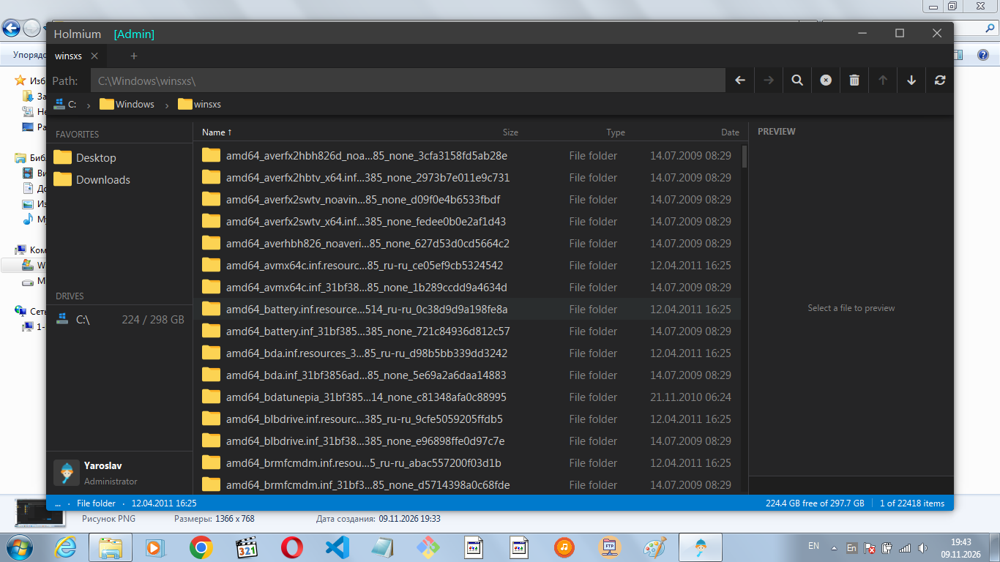



  <!-- ЗАМЕНИТЕ ССЫЛКУ НА ВАШ ЛОГОТИП, КОГДА ЗАГРУЗИТЕ ЕГО В РЕПОЗИТОРИЙ -->
  
  
  <h1>Holmium File Explorer</h1>
  
<b>A fast, minimalist, Windows commercial file manager built with Python & PySide2.</b>

  <!-- БЕЙДЖИ -->
  
  
  
  
  

---

## 📸 Screenshots

<!-- ЗАМЕНИТЕ ПУТИ К КАРТИНКАМ, КОГДА ДОБАВИТЕ ИХ В ПАПКУ docs/screenshots/ -->

  
  
  
  
<i>VSCode dark+ like theme and TC like functional. Light theme in processing now.</i>

## ✨ Key Features

- **Blazing Fast** — Instant folder opening with tens of thousands of files (built on QListView + background threads).
- **Tabs & History** — Multiple tabs with independent navigation history.
- **Built-in Search** — Recursive search by mask (`r_*.ext`, `r_**.ext`, `search .ext`, `search .ext --recursive`) without relying on the heavy Windows indexer.
- **Command Palette** — Invoke system windows and commands via `holmium://settings`, `holmium://about`, `holmium://search ...`, `holmium://ftp`.
- **Archive Handling** — Built-in ZIP packing/unpacking with a progress bar (without support RAR).
- **Text Editor** — Built-in editor with syntax highlighting for Python & JSON. Other languages will be support later.
- **Advanced Drag & Drop** — Custom "ghost" visualization with `Ctrl` support for copying.
- **FTP Client** — Direct connection to your smartphone (only FTP without SFTP).
- **HACM/ACM (YPACMv2)** — Custom access color marking for system folders and files (*Settings → Enable ACM*).

## 📦 Installation & Usage

1. Go to the [Releases](https://github.com/TermoRadiactiveCat/Holmium-File-Explorer/releases) page.
2. Download the latest `Holmium.exe` (or the binary for your platform).
3. Run the executable. **No Python installation is required.**

> **Note for macOS/Linux:** Builds for these platforms are provided on a best-effort basis. The primary target is Windows 7/8/10/11.

## 🧬 Relationship to YellowPather-Lite

Holmium is the direct successor to **[YellowPather-Lite](https://github.com/TermoRadiactiveCat/YellowPather-Lite)**. 

The Lite project is now **frozen** and receives no new features. It remains available for historical reference and for users who need the older PyQt5/GPLv3-based codebase. All new development, features, and updates are focused exclusively on Holmium.

## ⚖️ License & Legal

Holmium is **proprietary commercial software**. The terms of use are defined in the **[EULA.md](EULA.md)**.

However, Holmium dynamically links against third-party open-source libraries. All required copyright notices and license texts are provided in the following documents:

- **[THIRD_PARTY_LICENSES.md](THIRD_PARTY_LICENSES.md)** — Full list of third-party components and their licenses.
- **[LGPL-3.0.txt](LGPL-3.0.txt)** — Full text of the GNU Lesser General Public License v3.0 (applicable to PySide2/Qt).

In accordance with the LGPL-3.0, users have the right to replace the PySide2 libraries used by Holmium with compatible versions. The source code of Holmium itself remains closed.

## ✉️ Contact

For commercial licensing inquiries, bug reports, or feature requests:
- **GitHub Issues:** [Create an issue](https://github.com/TermoRadiactiveCat/Holmium-File-Explorer/issues)
- **Email:** [verrysillvereagle@gmail.com]

---

Made with ❤️ and Python
