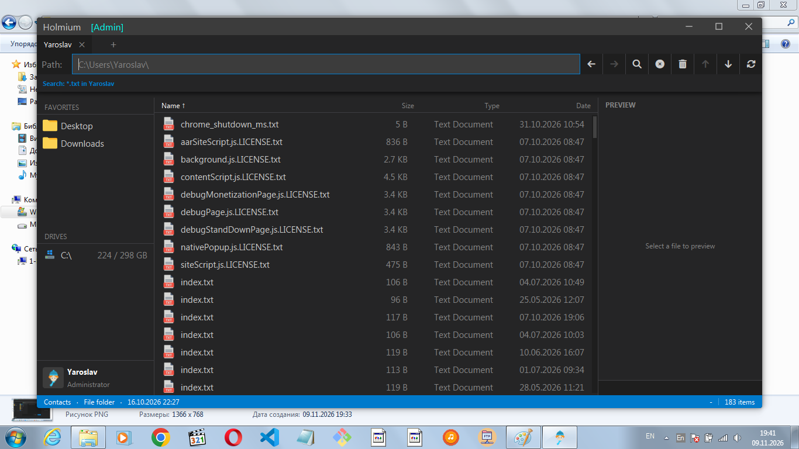
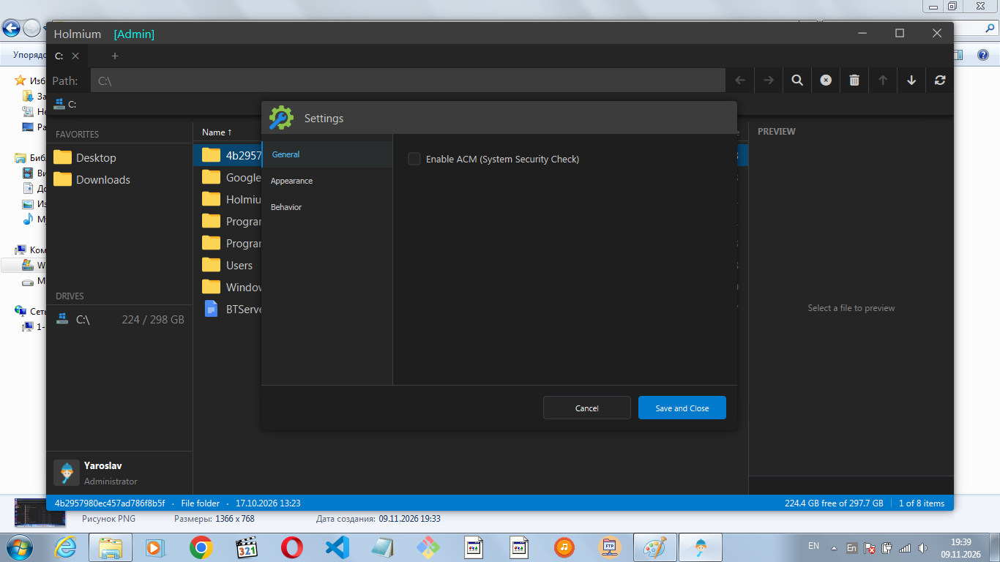



  <h1>Holmium File Explorer</h1>
  
<b>A fast, minimalist, Windows-only commercial file manager built with Python & PySide2.</b>

  

    <b><a href="#english">English</a></b> | <b><a href="#russian">Русский</a></b>
  

  

  <!-- БЕЙДЖИ -->
  
  
  
  
  

---

## 🇬🇧 English

### 📸 Screenshots

  
  
  
  
<i>VSCode dark+ like theme and TC like functional. Light theme in processing now.</i>

### What's new in version 1.0.1:
- **Archive Handling** - Added extractor for RAR/TAR formats (unrarw64.exe/tarfile).

### ✨ Key Features
- **Blazing Fast** — Instant folder opening with tens of thousands of files (built on QListView + background threads).
- **Tabs & History** — Multiple tabs with independent navigation history.
- **Built-in Search** — Recursive search by mask (`r_*.ext`, `r_**.ext`, `search .ext`, `search .ext --recursive`) without relying on the heavy Windows indexer.
- **Command Palette** — Invoke system windows and commands via `holmium://settings`, `holmium://about`, `holmium://search ...`, `holmium://ftp`.
- **Archive Handling** — Built-in ZIP packing/unpacking and RAR/TAR unpacking with a progress bar.
- **Text Editor** — Built-in editor with syntax highlighting for Python & JSON. Other languages will be supported later.
- **Advanced Drag & Drop** — Custom "ghost" visualization with `Ctrl` support for copying.
- **FTP Client** — Direct connection to your smartphone (only FTP without SFTP).
- **HACM/ACM (YPACMv2)** — Custom access color marking for system folders and files (*Settings → Enable ACM*).

### 📦 Installation & Usage
1. Go to the [Releases](https://github.com/TermoRadiactiveCat/Holmium-File-Explorer/releases) page.
2. Download the latest `Holmium.zip` archive and extract it to any convenient folder.
3. Run `Holmium.exe`. **No Python installation is required.**

> **Note for macOS/Linux:** Not supported. The primary target is Windows 7/8/10/11.

### 🧬 Relationship to YellowPather-Lite
Holmium is the direct successor to **[YellowPather-Lite](https://github.com/TermoRadiactiveCat/YellowPather-Lite)**. 
The Lite project is now **frozen** and receives no new features. It remains available for historical reference and for users who need the older PyQt5/GPLv3-based codebase. All new development, features, and updates are focused exclusively on Holmium.

### ⚖️ License & Legal
Holmium is **proprietary commercial software**. The terms of use are defined in the **[EULA.md](EULA.md)**.

However, Holmium dynamically links against third-party open-source libraries. All required copyright notices and license texts are provided in the following documents:
- **[THIRD_PARTY_LICENSES.md](THIRD_PARTY_LICENSES.md)** — Full list of third-party components and their licenses.
- **[LGPL-3.0.txt](LGPL-3.0.txt)** — Full text of the GNU Lesser General Public License v3.0 (applicable to PySide2/Qt).

In accordance with the LGPL-3.0, users have the right to replace the PySide2 libraries used by Holmium with compatible versions. The source code of Holmium itself remains closed.

### ✉️ Contact
For commercial licensing inquiries, bug reports, or feature requests:
- **GitHub Issues:** [Create an issue](https://github.com/TermoRadiactiveCat/Holmium-File-Explorer/issues)
- **Email:** [verrysillvereagle@gmail.com](mailto:verrysillvereagle@gmail.com)

---
---

## 🇷🇺 Русский

### 📸 Скриншоты

  
  
  
  
<i>Тёмная тема в стиле VSCode dark+ и функционал в духе Total Commander. Светлая тема в разработке.</i>

### Что нового в версии 1.0.1:
**Работа с архивами** - Добавлен распаковщик для форматов типа RAR/TAR (unrarw64.exe/tarfile).

### ✨ Ключевые возможности
- **Молниеносная скорость** — Мгновенное открытие папок с десятками тысяч файлов (на базе QListView и фоновых потоков).
- **Вкладки и история** — Несколько вкладок с независимой историей навигации.
- **Встроенный поиск** — Рекурсивный поиск по маске (`r_*.ext`, `r_**.ext`, `search .ext`, `search .ext --recursive`) без использования тяжелого индексатора Windows.
- **Командная палитра** — Вызов системных окон и команд через `holmium://settings`, `holmium://about`, `holmium://search ...`, `holmium://ftp`.
- **Работа с архивами** — Встроенная упаковка/распаковка ZIP, распаковка RAR/TAR с индикатором прогресса.
- **Текстовый редактор** — Встроенный редактор с подсветкой синтаксиса для Python и JSON. Другие языки будут добавлены позже.
- **Продвинутый Drag & Drop** — Собственная визуализация «призрака» файла с поддержкой `Ctrl` для копирования.
- **FTP-клиент** — Прямое подключение к смартфону (только FTP, без SFTP).
- **HACM/ACM (YPACMv2)** — Пользовательская цветовая маркировка прав доступа для системных папок и файлов (*Настройки → Включить ACM*).

### 📦 Установка и использование
1. Перейдите на страницу [Релизов](https://github.com/TermoRadiactiveCat/Holmium-File-Explorer/releases).
2. Скачайте последний архив `Holmium.zip` и распакуйте его в любую удобную папку.
3. Запустите `Holmium.exe`. **Установка Python не требуется.**

> **Примечание для macOS/Linux:** Не поддерживается. Основная цель — Windows 7/8/10/11.

### 🧬 Связь с YellowPather-Lite
Holmium — прямой преемник **[YellowPather-Lite](https://github.com/TermoRadiactiveCat/YellowPather-Lite)**. 

Проект Lite теперь **заморожен** и не получает новых функций. Он остается доступным для исторического ознакомления и для пользователей, которым нужна старая кодовая база на PyQt5/GPLv3. Все новые разработки, функции и обновления сосредоточены исключительно на Holmium.

### ⚖️ Лицензия и правовая информация
Holmium — это **проприетарное коммерческое программное обеспечение**. Условия использования определены в **[EULA.md](EULA.md)**.

Однако Holmium динамически связывается со сторонними библиотеками с открытым исходным кодом. Все необходимые уведомления об авторских правах и тексты лицензий предоставлены в следующих документах:
- **[THIRD_PARTY_LICENSES.md](THIRD_PARTY_LICENSES.md)** — Полный список сторонних компонентов и их лицензий.
- **[LGPL-3.0.txt](LGPL-3.0.txt)** — Полный текст GNU Lesser General Public License v3.0 (применимо к PySide2/Qt).

В соответствии с LGPL-3.0 пользователи имеют право заменять библиотеки PySide2, используемые в Holmium, на совместимые версии. Исходный код самого Holmium остается закрытым.

### ✉️ Контакты
По вопросам коммерческого лицензирования, сообщениям об ошибках или запросам функций:
- **GitHub Issues:** [Создать issue](https://github.com/TermoRadiactiveCat/Holmium-File-Explorer/issues)
- **Email:** [verrysillvereagle@gmail.com](mailto:verrysillvereagle@gmail.com)

---

Made with ❤️ and Python
